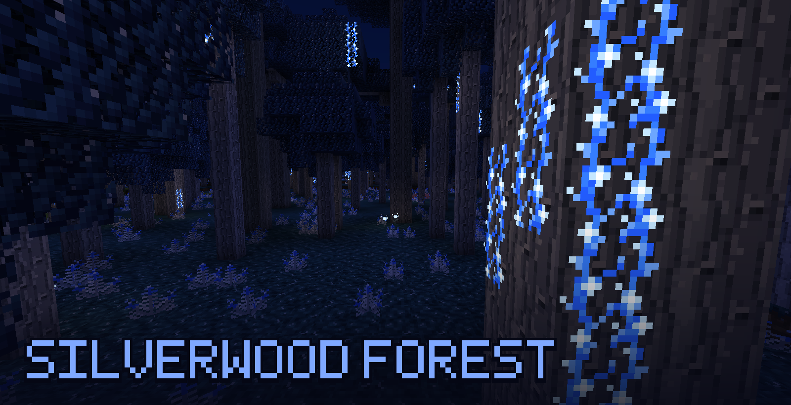
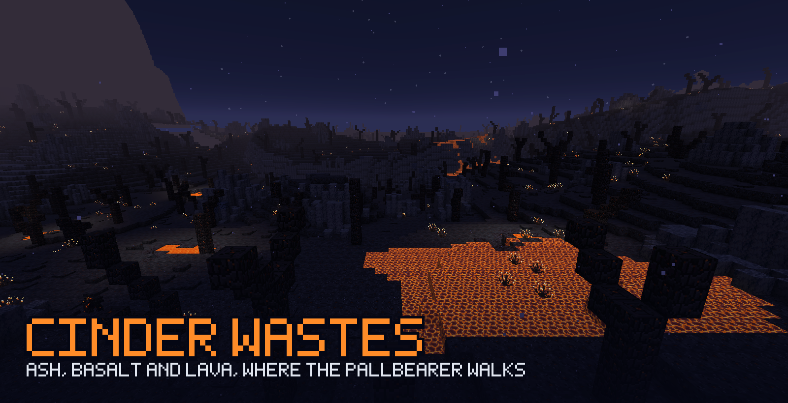
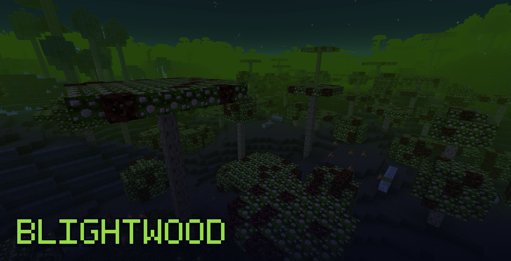
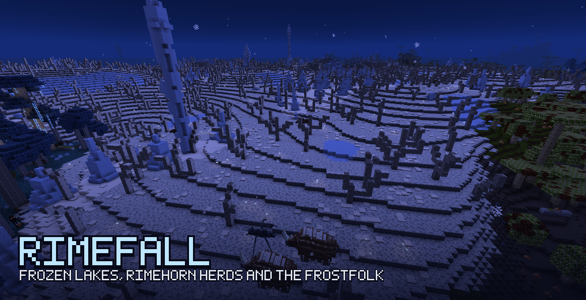
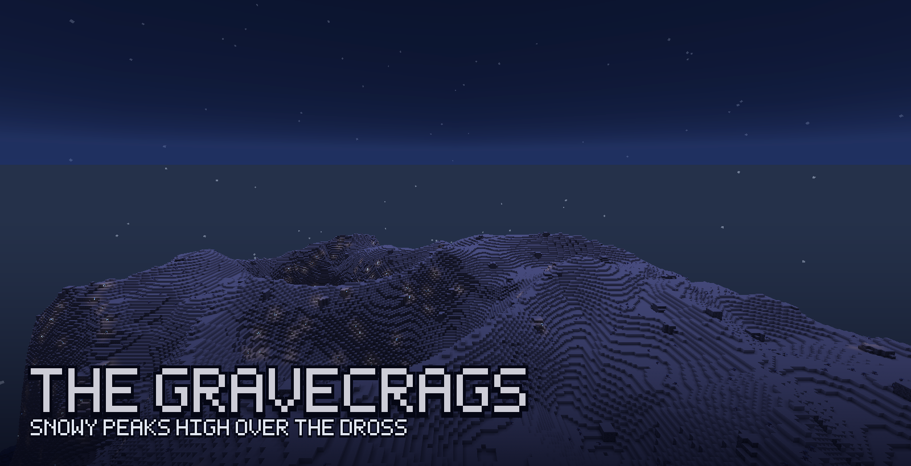
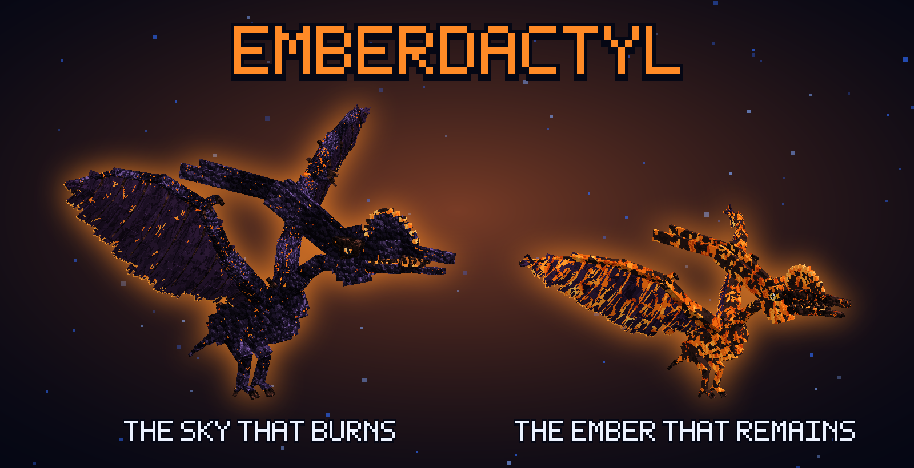

**Blue portals have appeared across the world, in shapes no one built. Something on the other side wants in.**

The Dross is a dangerous dimension for the mid-to-late game.

## Getting in

- **Find a Weathered Letter** 
- **Meet the Dross Trader** 
- **Forge the Rift Key.** 
- **Light the portal.** 

## Biomes

The Dross is always night. Five biomes, each with its own ground, plants, fog and mobs.

<b>Silverwood Forest</b>: the dark forest round the hub, its silverwood trees hung with glowing Stormvine. Moose wander under them.

<b>Cinder Wastes</b>: ash, basalt and lava pools. Stone and lava golems, the Pallbearer and Cinder Hermits in their shells roam here, and it's home to the Cinder Colossus and the Emberdactyl.

<b>Blightwood</b>: a rotting fungal forest full of plague rats. Under it, the sewers lead to the Rat King.

<b>Rimefall</b>: frozen lakes, Rimehorn herds, moose and Pond Skaters, and the villages of the Frostfolk, where the Huntsman rides.

<b>The Gravecrags</b>: snow-capped peaks and cliffs, far out from the hub.

## Bosses

Each boss guards its own lair, and once beaten, it never comes back. Travel further out and you'll find more.

<b>Trophies</b>: every player who helps beat a boss gets a trophy. Right-click it to change its pose.

<b>The Cinder Colossus</b>: a hulking golem with volcanoes on its back that cracks open into a molten core as you fight it.

<b>The Rat King</b>: he sleeps on his hoard of gold at the end of the sewers, until you wake him.

<b>The Huntsman</b>: he rides his Alpha Moose through frozen Rimefall, and when you knock him off, you fight them both at once.

<b>The Emberdactyl</b>: it circles its volcano in the Cinder Wastes, guarding its egg. Bring it down and the egg hatches.

## Requirements

- **Minecraft 1.20.1** with **Forge**.
- **[GeckoLib](https://www.curseforge.com/minecraft/mc-mods/geckolib)** is required.
- Install it on both the client and the server.

## Modpacks and permissions

- **Modpacks are welcome.** No need to ask, but please credit Reg21meme and link back here.
- Please **don't modify the mod, re-upload it, or reuse its code, textures, models or sounds** without asking me first.

## Beta

This mod is in beta development.

